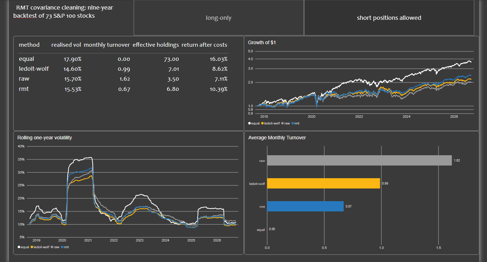
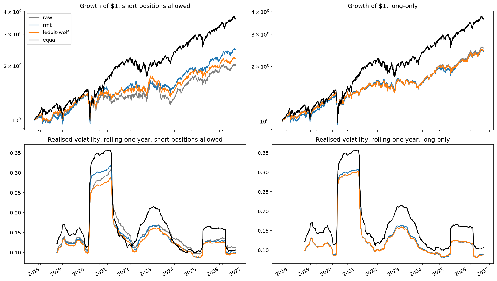
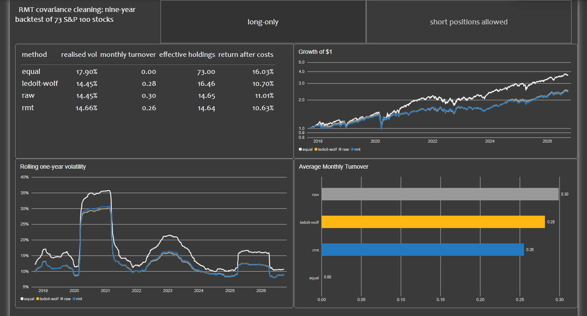

# Cleaning noisy covariance matrices with random matrix theory

When you estimate how 73 stocks move together from a year of data, most of what you get back is noise. That would be a small problem if nobody used the result, but portfolio optimisers do, and they are extremely good at finding and exploiting that noise. In this project I used random matrix theory, a tool that began in nuclear physics, to separate the real structure in a stock correlation matrix from the noise, and then tested over nine years of out-of-sample data whether cleaning the matrix actually leads to better portfolios.



## What I found

- **Most of the matrix was noise.** Out of 73 eigenvalues, only 7 stood clear of the band that pure noise would produce. The largest one, the market itself, carried 36% of all the variance on its own.
- **Cleaning made the portfolios far more stable.** With short positions allowed, the raw matrix ran on average about 240% long and 140% short, concentrated in the equivalent of three or four stocks. Cleaning cut the gross exposure from 3.8 to 2.5 and roughly doubled the effective number of holdings (6.8 against 3.5).
- **RMT traded the least, which made it the cheapest to run.** It had the lowest turnover of the matrix-based methods at every window length I tested, buying and selling 0.67 times its value each month against 0.99 for Ledoit-Wolf and 1.62 for the raw matrix. With a cost of $c$ per unit traded, the yearly drag is about $12 \, c \times \text{turnover}$, so at 0.1% that came to about 0.8 percentage points a year for RMT, 1.2 for Ledoit-Wolf and 1.9 for raw. RMT had the best return after costs of the three at every cost level from 0.05% to 0.2%, and its lead grew as costs rose.
- **But it didn't beat the industry standard on risk.** Ledoit-Wolf shrinkage gave the lowest volatility (14.6%, against 15.5% for RMT and 15.7% for the raw matrix), and a bootstrap test showed that gap was real: Ledoit-Wolf came out ahead of RMT in 99.85% of 2,000 resamples.
- **Cleaning mattered most when data was scarce.** With only six months of data, the raw matrix did worse than simply holding every stock equally, and cleaning cut volatility by almost four percentage points. With two years of data, it started throwing away real information.
- **Constraints did the cleaning for us.** Once short positions were banned and each stock capped at 10%, all three methods ended up at about 14.5% volatility.

## The problem I wanted to look at

The question behind this project is simple: how do you build the least risky portfolio from a set of stocks? The answer depends entirely on the covariance matrix, which describes how much each stock moves and how the stocks move together. The catch is that we never know the true matrix. We have to estimate it from past returns.

With 73 stocks, the matrix has 73 × 72 / 2 = 2,628 distinct correlations, and with one year of data each one is estimated from only 252 days. Every one of those estimates is off by a little, purely by chance. Individually the errors are small, but together they create combinations of stocks that look almost riskless in the data and aren't. The optimiser, which is specifically hunting for low risk, piles into exactly those combinations. What comes out is a portfolio that is much riskier than it thinks, with extreme long and short positions that change completely from one month to the next.

So the real question became: which parts of the estimated matrix can I trust?

## The maths

### Eigenvalues as risks

I worked with the correlation matrix $C$, which is the covariance matrix with every stock scaled to the same volatility. Because $C$ is symmetric, it can be broken down into eigenvectors and eigenvalues:

$$C = \sum_{k=1}^{N} \lambda_k \, v_k v_k^\top$$

Each eigenvector $v_k$ is a portfolio, a set of weights across the 73 stocks, and its eigenvalue $\lambda_k$ is the variance of that portfolio. So the eigenvalues tell me how the total risk is split up. They add up to $N = 73$, so $\lambda_k / N$ is the share of total variance carried by portfolio $k$.

In our data, the largest eigenvalue was $\lambda_1 = 26.5$, or 36% of the total. Its eigenvector put a positive weight on every stock, so it is simply the market: the shared movement of everything at once. The next few eigenvectors picked out sectors, groups of stocks that move together on top of the market.

### What pure noise looks like

The Marchenko–Pastur law comes from random matrix theory, which began in nuclear physics. In the 1950s, Eugene Wigner wanted to understand the energy levels of heavy nuclei such as uranium, but the interactions between hundreds of protons and neutrons were far too complicated to calculate. Instead, he modelled the system's Hamiltonian as a matrix with random entries, and found that its eigenvalues reproduced the statistics of the real energy levels, such as how far apart neighbouring levels tend to be. Marchenko and Pastur (1967) later worked out the equivalent result for the kind of matrix we have here: one estimated from a finite amount of noisy data.

Suppose I had $N$ stocks that were completely unrelated, and I estimated their correlation matrix from $T$ days of data. The true matrix would have every eigenvalue equal to 1, but the estimated eigenvalues would spread out. The law says that, for $q = N/T$, they fall between

$$\lambda_\pm = \left(1 \pm \sqrt{q}\right)^2$$

For the full ten years, $q = 73/2513 = 0.029$, so noise eigenvalues lie between 0.69 and 1.37. For a single year, $q = 73/252 = 0.29$, and the range widens dramatically to between 0.21 and 2.37. That is the heart of the problem: with a year of data, noise alone can make some combinations of stocks look as if they had almost five times less variance than they really do, or about half the volatility.

Any eigenvalue well above the upper edge reflects genuine structure, and anything inside the band can't be told apart from noise. In our data, only 7 of the 73 eigenvalues cleared the upper edge.

One refinement comes from Laloux et al. (1999). The market eigenvalue alone takes 36% of the variance, so the remaining eigenvalues share only what is left. Scaling the noise band by $\sigma^2 = 1 - \lambda_1 / N \approx 0.64$ lowers the upper edge and keeps 12 factors instead of 7. I tested both versions in the backtest.

Marchenko–Pastur assumes well-behaved returns, and stock returns have fat tails, so I also checked it directly. I shuffled each stock's returns in time, which keeps every stock's own distribution but destroys any correlation between them. The largest shuffled eigenvalue was 1.38, against a predicted edge of 1.37, so the theory held up.

### Cleaning the matrix

To clean the matrix, I used eigenvalue clipping (Laloux et al., 1999). I kept the eigenvalues above the noise edge as they were, replaced all the others with their average so that the total variance stayed the same, and left the eigenvectors unchanged. I then rescaled the result so that every stock still has a correlation of 1 with itself, and multiplied it back by each stock's own volatility to get a covariance matrix for the optimiser: $\tilde\Sigma = D \tilde C D$, where $D$ is the diagonal matrix of volatilities.

### Why noise breaks the optimiser

The minimum-variance portfolio has a closed form:

$$w = \frac{\Sigma^{-1} \mathbf{1}}{\mathbf{1}^\top \Sigma^{-1} \mathbf{1}}, \qquad \Sigma^{-1} = \sum_k \frac{1}{\lambda_k} \, v_k v_k^\top$$

Here $\lambda_k$ and $v_k$ are the eigenvalues and eigenvectors of the covariance matrix $\Sigma$ rather than of $C$, but the idea is the same. The second expression shows exactly where things go wrong. The inverse weights each direction by $1/\lambda_k$, so the smallest eigenvalues dominate the portfolio, and those are precisely the ones noise makes too small. The optimiser loads up on them, and the risk it predicts is far too low. Theory says that with one year of data, noise alone should make the realised volatility about $1/(1-q) \approx 1.4$ times the prediction. On the real data the raw matrix's ratio was 1.83, so noise explains most of the gap, and the rest comes from markets changing from one year to the next.

### The benchmark: Ledoit-Wolf shrinkage

The standard industry fix takes a gentler approach. Rather than deciding which eigenvalues are noise, Ledoit-Wolf blends the sample matrix $S$ with a simple target, in which every stock is equally risky and nothing is correlated:

$$\Sigma_{\text{LW}} = (1 - \delta) \, S + \delta \, \mu I$$

Here $\mu$ is the average variance and the shrinkage intensity $\delta$ is chosen from the data. The effect is to pull every eigenvalue a little towards the average, large ones down and small ones up. RMT clipping is all or nothing by comparison, and that difference turned out to matter.

## How I tested it

I replayed history month by month, as if I had been managing a portfolio in real time from September 2017 to September 2026. At each of 108 monthly rebalances:

1. I took only the previous 252 trading days of returns, which is all an investor would have had at that point.
2. I estimated the matrix four ways: raw, RMT-cleaned, Ledoit-Wolf, and equal weights as a naive baseline that ignores the matrix entirely.
3. I built the minimum-variance portfolio from each one and held it for the next 21 trading days.

No portfolio ever saw the days it was tested on. I ran everything twice: once allowing short positions, which shows the pure effect of the matrix, and once long-only with at most 10% in any stock, which is closer to what a real fund could hold.

Besides realised volatility, I tracked a few measures of how each portfolio was built:

- **Turnover**, $\sum_i |w_i^{\text{new}} - w_i^{\text{old}}|$: the total value bought and sold at each rebalance.
- **Effective holdings**, $1 / \sum_i w_i^2$: roughly how many stocks the portfolio was really spread across, from 1 if everything sits in one stock up to 73 for equal weights.
- **Gross exposure**, $\sum_i |w_i|$: the total size of all positions, long and short.
- **Return after costs**, charging 0.1% per unit of turnover.

To check whether the differences were real or just luck, I used a block bootstrap, where I rebuilt the nine years of returns 2,000 times from randomly chosen one-month blocks and counted how often each method came out ahead. I also reran the backtest with six-month and two-year windows, with the COVID crash removed, and with different trading costs.

## Results

With short positions allowed:

| Method | Realised volatility | Monthly turnover | Effective holdings | Gross exposure | Return after costs |
|---|---|---|---|---|---|
| Raw | 15.7% | 1.62 | 3.5 | 3.82 | 7.1% |
| RMT | 15.5% | 0.67 | 6.8 | 2.52 | 10.4% |
| Ledoit-Wolf | **14.6%** | 0.99 | 7.0 | 2.83 | 8.6% |
| Equal weights | 17.9% | 0.00 | 73.0 | 1.00 | 16.0% |

All three minimum-variance portfolios were clearly less risky than equal weights, so using a covariance matrix was worth it. Among them, Ledoit-Wolf had the lowest risk, and RMT barely improved on the raw matrix. Where RMT stood out was in how it built the portfolio: the raw matrix ran on average about 240% long and 140% short, concentrated in the equivalent of three or four stocks, and cleaning cut that back sharply.

The bootstrap made the ranking on risk clear. Ledoit-Wolf had lower volatility than the raw matrix in all 2,000 resamples, and lower than RMT in 99.85% of them. RMT came out ahead of the raw matrix in only 66%, so its small improvement could easily have been luck.

Equal weights had the highest return, but this was a strong bull market, minimum variance deliberately avoids the riskier growth stocks that led it, and it doesn't aim for return in the first place.

How the results changed with the length of the estimation window:

| Method | 6 months | 1 year | 2 years |
|---|---|---|---|
| Raw | 17.9% | 15.7% | 16.2% |
| RMT | 14.2% | 15.5% | 17.5% |
| Ledoit-Wolf | **13.7%** | **14.6%** | **15.8%** |
| Equal weights | 17.5% | 17.9% | 18.5% |
| RMT, market-adjusted edge | 13.8% | 15.6% | 16.8% |

Each column is tested over a slightly different period, because a longer window has to wait longer for its first estimate: the six-month run starts testing in March 2017 and the two-year run in September 2018, so it misses the calm 2017 market. That is why even equal weights, which don't use the window at all, change from column to column. The fair comparison is within each column rather than across them.

This table shows the theory most clearly. With six months of data, $q = 0.58$ and the noise band is very wide, and the raw matrix did worse than holding every stock equally. That is the situation random matrix theory was designed for, and cleaning made a large difference. With two years, $q = 0.15$, the band is much narrower, and some of the eigenvalues inside it were real. Flattening them threw away useful hedges, and RMT ended up as the riskiest of the matrix-based methods. The market-adjusted edge, which keeps more factors, helped at six months and two years but made no real difference at one year.



RMT's weakest moment was the COVID crash. Going into 2020, the matrix was estimated in a calm year, when only a few factors stood out and clipping had flattened everything else. When the crash suddenly changed how stocks moved together, that simplified picture was the most wrong.

In the long-only portfolios, with at most 10% in any stock, the differences almost disappeared:

| Method | Realised volatility, short positions allowed | Realised volatility, long-only | Monthly turnover, long-only |
|---|---|---|---|
| Raw | 15.7% | 14.4% | 0.30 |
| RMT | 15.5% | 14.7% | 0.26 |
| Ledoit-Wolf | 14.6% | 14.4% | 0.28 |
| Equal weights | 17.9% | 17.9% | 0.00 |

Every long-only portfolio was less risky than its unconstrained version. Banning short positions stops the optimiser from making large bets on the directions where the matrix is most wrong, so the constraint itself does much of the cleaning, a result first shown by Jagannathan and Ma (2003).



## What I took away

I started this project expecting RMT to beat the standard method, and it didn't, at least not on risk: it was slightly riskier than Ledoit-Wolf, by about 0.9 percentage points. But I think the more interesting result is why. RMT gave portfolios that were far more stable and cheaper to run, and it did so with a clear, principled rule for deciding what is noise. Its strength showed up exactly where the theory says it should, when data is scarce relative to the number of stocks, and its weakness showed up where the theory also predicts, when real but weak structure is hiding inside the noise band.

The next step would be to combine the two ideas, where we can either shrink the noise eigenvalues towards each other rather than flattening them completely, or use the more recent rotationally invariant estimators that also stem from the same random matrix theory.

## Limitations

- **Survivorship bias.** I used today's S&P 100, so every company in the data survived the decade, which flatters the absolute returns. The comparison between methods is fairer because every method faced the same stocks.
- **Trading costs** only enter the return after costs. I didn't model market impact or the cost of borrowing stocks to short them.
- **Weights were held fixed within each month**, so turnover slightly understates the trading a real portfolio would need.
- **Ledoit-Wolf** here is scikit-learn's version, which shrinks towards a scaled identity matrix. Other targets, such as constant correlation, can work better for stocks.
- **One universe and one period.** A different market or decade could give a different ranking.

## Data

- **73 stocks** from the current S&P 100, keeping only those with at least 98% of the price history.
- **2,513 trading days**, from September 2016 to September 2026, using dividend- and split-adjusted closes from Yahoo Finance.
- Stored in a local **PostgreSQL** database. Daily returns, rolling volatility and drawdowns are computed in SQL as views, using window functions, and loaded into Python with SQLAlchemy.

## Repository structure

```
rmt-portfolio-risk/
├── sql/
│   ├── schema.sql            asset and price tables
│   ├── views.sql             daily returns, rolling volatility and drawdowns
│   ├── checks.sql            data quality checks
│   └── analysis.sql          exploratory queries
├── src/
│   ├── pull_prices.py        downloads prices from Yahoo Finance into PostgreSQL
│   ├── data.py               loads returns from PostgreSQL
│   ├── rmt.py                Marchenko–Pastur tools, clipping, minimum variance
│   └── backtest.py           backtest engine, summary statistics, bootstrap
├── notebooks/
│   ├── 01_eda.ipynb          exploratory analysis of returns and correlations
│   ├── 02_rmt.ipynb          random matrix theory and cleaning
│   └── 03_backtest.ipynb     rolling backtest and robustness checks
├── powerbi/
│   ├── rmt_dashboard.pbix    Power BI dashboard
│   └── data/                 backtest results exported for the dashboard
├── figures/                  charts used in the notebooks and this README
├── export_powerbi.py         exports the backtest results to CSV
└── requirements.txt
```

## How to run

To do this, you'll need Python and a local PostgreSQL server. First, set up the environment:

```
python -m venv .venv
.venv\Scripts\activate
pip install -r requirements.txt
$env:PGPASSWORD = "<your postgres password>"
```

These commands are for Windows PowerShell. On macOS or Linux, use `source .venv/bin/activate` and `export PGPASSWORD="<your postgres password>"` instead.

Then build the database. These commands use `psql`, but the SQL files can equally be run from pgAdmin:

```
psql -U postgres -c "CREATE DATABASE rmt"
psql -U postgres -d rmt -f sql/schema.sql
psql -U postgres -d rmt -f sql/views.sql
python src/pull_prices.py
```

`pull_prices.py` downloads the prices from Yahoo Finance, keeps the stocks with at least 98% of the history and loads them into the database. Yahoo occasionally revises its adjusted prices, so a fresh download may give results that differ very slightly from mine. `sql/checks.sql` contains a few data quality checks that are worth running at this point.

Finally, run the notebooks in order with `jupyter lab`. To rebuild the dashboard data, run `python export_powerbi.py`. When opening the `.pbix` file on another computer, point Power BI at your own copy of the CSVs under Transform data → Data source settings.

## References

- Wigner, E. P. (1955). Characteristic vectors of bordered matrices with infinite dimensions. *Annals of Mathematics*.
- Marchenko, V. A. and Pastur, L. A. (1967). Distribution of eigenvalues for some sets of random matrices. *Mathematics of the USSR-Sbornik*.
- Laloux, L., Cizeau, P., Bouchaud, J.-P. and Potters, M. (1999). Noise dressing of financial correlation matrices. *Physical Review Letters*.
- Plerou, V., Gopikrishnan, P., Rosenow, B., Amaral, L. A. N. and Stanley, H. E. (1999). Universal and nonuniversal properties of cross correlations in financial time series. *Physical Review Letters*.
- Jagannathan, R. and Ma, T. (2003). Risk reduction in large portfolios: why imposing the wrong constraints helps. *Journal of Finance*.
- Ledoit, O. and Wolf, M. (2004). A well-conditioned estimator for large-dimensional covariance matrices. *Journal of Multivariate Analysis*.
- Bun, J., Bouchaud, J.-P. and Potters, M. (2017). Cleaning large correlation matrices: tools from random matrix theory. *Physics Reports*.
